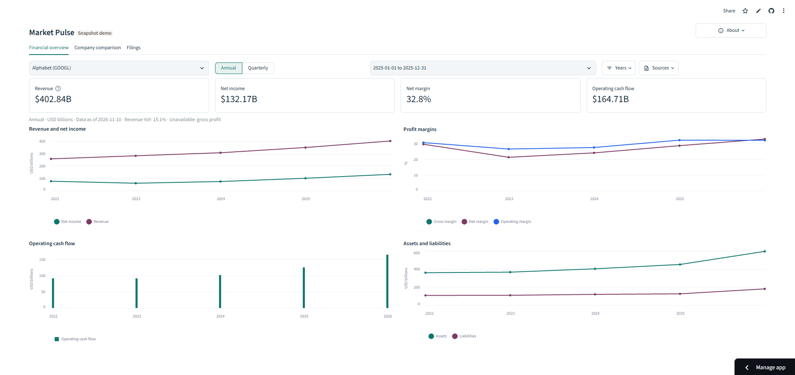
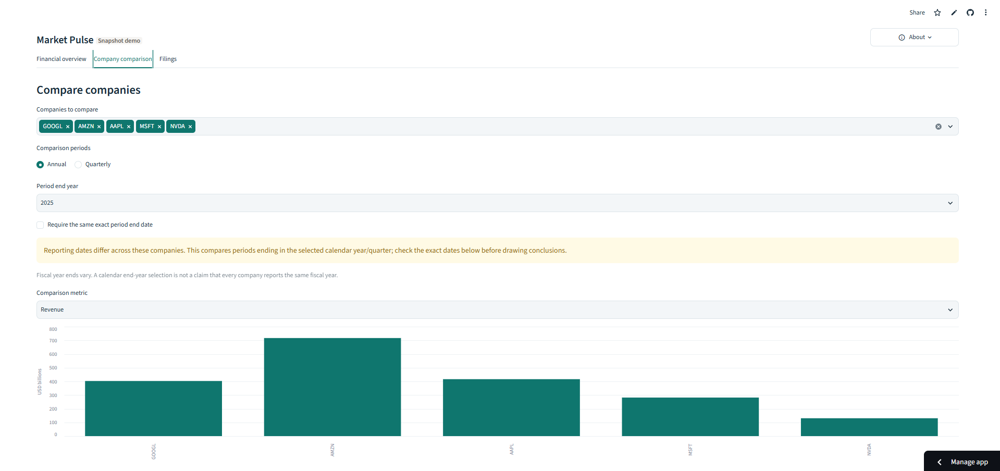
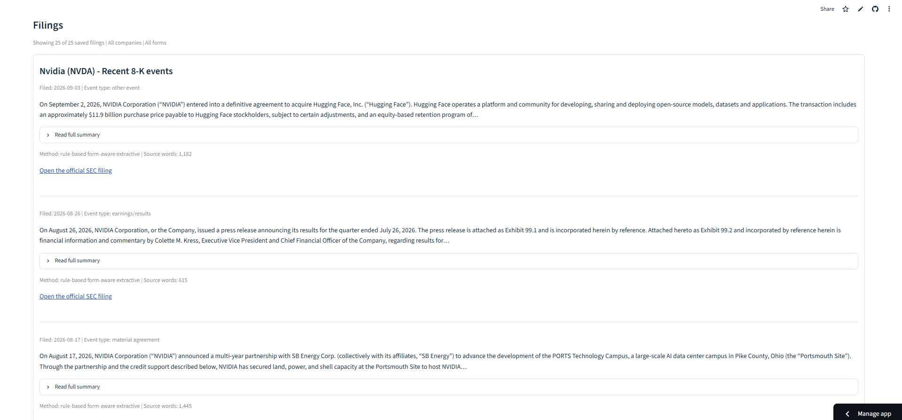

# Market Pulse

Market Pulse is a local financial dashboard for Nvidia, Microsoft, Alphabet,
Amazon and Apple. Explore PostgreSQL-backed financial trends, compare company
results, and browse source-linked SEC filing highlights. No AI API key is required.

**[CHECK OUT THE LIVE DEMO APP HERE](https://dashboardpy-vb47k7ptczxxujve3xrqk3.streamlit.app/)**

## How it looks

**Financial overview** — company KPIs, financial trends, margins and cash flow.



**Company comparison** — compare reported financial metrics across the watchlist.



**Filings** — browse dated filing highlights and open the original SEC disclosures.



The project goal is an integrated **financial analytics and AI research
platform**: PostgreSQL-backed financial KPIs and company comparisons, plus
filing-based answers with source citations, in one Streamlit application.
Financial analytics is implemented through upgrade 5, with a public frozen-data
demo linked above. Retrieval and cited AI answers remain optional future work. See the
[project brief and delivery milestones](docs/problem.md) and
[target architecture](docs/architecture.md#target-architecture-planned). The [ordered upgrade roadmap](docs/problem.md#agreed-upgrade-order)
records implementation status, branch names and the exhibit-ingestion prerequisite
before LLM extraction.

## Setup

The verified environment is **CPython 3.14.5 on Windows AMD64**. From the
repository root, create a fresh environment (use another name if `.venv` already
exists):

```powershell
py -3.14 -m venv .venv
& .\.venv\Scripts\Activate.ps1
python -m pip install pip==26.1.1
python -m pip install --require-hashes -r requirements.txt
python -m pip check
python -m scripts.environment
```

The lock pins all runtime dependencies and verifies their wheel hashes. It is
specific to this Python/OS target. See [reproducibility](docs/reproducibility.md)
for clean installation, lock regeneration and support limitations.

Before accessing the SEC, set `SEC_HEADERS["User-Agent"]` in `config.py` to
identify your project with a genuine contact email. The same file configures
the watchlist, accepted forms (`8-K`, `10-Q`, `10-K`), and per-company limit.

## Run

Run commands from the repository root with the virtual environment active.
Operator scripts now live under `scripts/` and run as modules, for example
`python -m scripts.refresh_data`. The former `main.py` is now
`scripts/ingest_filings.py`. App launch paths remain `dashboard.py` locally and
`demo/dashboard.py` for the frozen public demo.

For the **frozen portfolio demo**, no PostgreSQL or credentials are needed:

```powershell
python -m streamlit run demo/dashboard.py
```

This reads the committed public snapshot (5 companies, financial observations and
filing highlights), shows its source dates, and never refreshes data automatically.
See [exact deployment steps](demo/README.md). Cloud entry point:
**`demo/dashboard.py`**, with its own Linux dependency lock in `demo/requirements.txt`.
Your existing root `dashboard.py` remains the local PostgreSQL version.

With PostgreSQL running and your dedicated database already created, configure
the connection once. The defaults are database `Market Pulse`, user `postgres`,
host `localhost`, port `5432`; command options support other values.

```powershell
python -m scripts.configure_database
python -m scripts.refresh_data
python -m streamlit run dashboard.py
```

Setup verifies the connection and saves it in ignored `.streamlit/secrets.toml`.
The password prompt hides your input. Keep this local file private. Future
terminals use these settings automatically; `DATABASE_URL`, when set, takes
precedence. PostgreSQL must run, but pgAdmin does not need to be open. The standard
Windows PostgreSQL 18 client library is detected automatically; see
[database setup](docs/database.md) for other paths.

`scripts/refresh_data.py` checks the connection/schema, fetches and validates XBRL facts,
then imports the complete batch into PostgreSQL. Failed refreshes preserve the
previous database results and display a warning. It does not refresh narrative
summaries. To reopen saved results, run only Streamlit. After a refresh,
rerun/reload the page to read the latest database snapshot. This upgrade does not
schedule updates or continuously poll the database.

The app has three tabs:

- **Financial overview:** annual/quarterly revenue, net income, margins, cash flow,
  assets and liabilities, with exact dates, KPI cards and source-value CSV export.
- **Company comparison:** selected companies and metric, period-end year/quarter,
  reporting dates and an optional exact-end-date requirement.
- **Filings:** the original company/form filters and grouped 8-K highlights.

Missing values stay unavailable. These are reported financial results, not
share-price charts. See [analytics contracts and limitations](docs/analytics.md).

To refresh the separate narrative filing browser:

```powershell
python -m scripts.ingest_filings
if ($LASTEXITCODE -eq 0) { python -m scripts.process_filings }
if ($LASTEXITCODE -eq 0) { python -m scripts.summarize_filings }
python -m streamlit run dashboard.py
```

| Entry point | Purpose | Output |
|---|---|---|
| `scripts/ingest_filings.py` | Retrieve recent filing metadata | `data/filings.json` |
| `scripts/process_filings.py` | Download HTML and extract text; record successes and failures | `data/raw_html/`, `data/clean_text/`, `data/processed_filings.json` |
| `scripts/summarize_filings.py` | Summarise successfully processed filings | `data/summaries.json` |
| `dashboard.py` | Financial charts, company comparisons and filing browser | Local Streamlit dashboard |
| `scripts/configure_database.py` | Verify and save a private local connection once | Ignored `.streamlit/secrets.toml` |
| `scripts/refresh_data.py` | Fetch/validate XBRL facts and transactionally import them | PostgreSQL + `data/refresh_status.json` |

The commands above use PowerShell; stop on any failure when running stages
manually on other shells. A failed stage returns a nonzero exit code. The
dashboard may still be opened to inspect previous results and failure details. 8-Ks are grouped in
one card per company, with dated entries ordered newest first and individual
source links. Long 8-K summaries have expandable full text; 10-Qs and 10-Ks keep
separate cards. Visible-record counts continue to count filings, not cards. The page
introduces Market Pulse, explains the company/form filters and filing types, and
shows the active selection. Routine refresh details are collapsed under Data
updates with Singapore timestamps; incomplete-update warnings remain visible.

The first two steps require network access for fresh data. Processing reuses
nonempty HTML files by accession number. Saved data is generated locally and
ignored by Git. To reopen existing results, run only the dashboard command.
Counts depend on available filings and processing failures; 25 is a configured
maximum for the default watchlist, not a guaranteed result.

Each stage replaces its main JSON output only after a complete nonempty successful
batch. On failures, partial batches or empty results, it preserves the previous
checkpoint and writes a status report (`data/metadata_status.json`,
`data/processing_status.json`, or `data/summaries_status.json`). The dashboard shows
run timestamps, warnings and per-company/per-filing errors. Partial successes are
recorded in reports; they are not mixed into older published checkpoints.

Requests use bounded retries for temporary failures. A 403 stops further network
requests in that stage and reports an access denial; repeated retries or changing
identities are not a remedy. Check the contact header and network access, wait
if access is rate-limited, and follow the [SEC access guidance](https://www.sec.gov/search-filings/edgar-search-assistance/accessing-edgar-data).
Cached HTML remains available, and invalid cached block pages are refetched.

## Structured financial facts

Collect XBRL financial facts independently of the filing summaries:

```powershell
python -m scripts.ingest_financials --start-date 2021-01-01 --as-of 2026-11-09
```

Replay the saved snapshots without accessing the SEC:

```powershell
python -m scripts.ingest_financials --offline --start-date 2021-01-01 --as-of 2026-11-09
```

The stage saves immutable raw snapshots, validated observations and per-metric
coverage to ignored `data/` files. Its history window is independent of the five
recent narrative filings per company. Missing/conflicting values are flagged;
exact dates keep instant, quarterly-length and cumulative facts distinct. No
financial charts or database are added in this step. See
[financial-fact contracts and limitations](docs/financial-facts.md).

## PostgreSQL storage

Validated financial facts can now be loaded into a dedicated PostgreSQL database:

```powershell
# Set DATABASE_URL locally using your own database credentials first.
python -m scripts.database migrate
python -m scripts.database import
python -m scripts.database status
```

Imports verify the raw snapshots, preserve candidates and source links, and load
all companies in one transaction. Repeating an import does not duplicate business
records. Database setup, the managed-Windows driver fallback, tests and backup
examples are in [the database guide](docs/database.md). The Filings tab reads JSON
summaries; the financial tabs query PostgreSQL.

## Repository

```text
AGENTS.md              Codex working conventions
config.py              Watchlist and request settings
dashboard.py           Local Streamlit launcher
demo/                  Public demo launcher, frozen snapshot and Linux lock
scripts/               Ingestion, processing, database, export and environment commands
src/ui/                Shared Streamlit layout, financial views and filing browser
src/                   Reusable SEC clients, parsing, analytics and persistence
migrations/            Checksum-tracked PostgreSQL schema changes
docs/                  Project brief, architecture and verification guidance
tests/                 Ingestion, dashboard and baseline integrity tests
evals/                 Frozen development cases, references and offline runner
reports/               Preserved before/after rule-based baseline results
requirements.in        Direct runtime dependency pins
requirements.txt       Complete Windows/CPython wheel hash lock
```

The entry points serve different pipeline stages; reusable code lives in `src/`.
See [the project brief](docs/problem.md),
[component contracts and recovery](docs/architecture.md), and
[checks and known gaps](docs/project-checks.md).

## Checks and limitations

Check Python syntax without importing optional dependencies or creating caches:

```powershell
python -c "import ast; from pathlib import Path; files = list(Path('.').glob('*.py')) + [p for folder in ('src', 'scripts', 'demo', 'tests', 'evals') for p in Path(folder).rglob('*.py')]; [ast.parse(p.read_text(encoding='utf-8'), filename=str(p)) for p in files]; print(f'Parsed {len(files)} Python files')"
```

Run offline regression checks after installing the application dependencies:

```powershell
python -B -m unittest discover -s tests -v
```

The suite uses mocked network responses, real HTML parsing, and Streamlit AppTest.
Reproduce the saved development baseline:

```powershell
python -m evals.run --verify reports/rule-based-baseline-v3.json
```

The [evaluation suite](evals/README.md) has 15 frozen development cases with
agent-reviewed references; human review remains pending. Preserved results are
in [reports](reports/README.md). This small excerpt/synthetic suite does not
establish production-wide quality. Offline checks do not verify current SEC
connectivity or browser appearance. The form-aware summariser targets `8-K` and
`10-Q`; `10-K` still uses the `10-Q` rules as a fallback.
