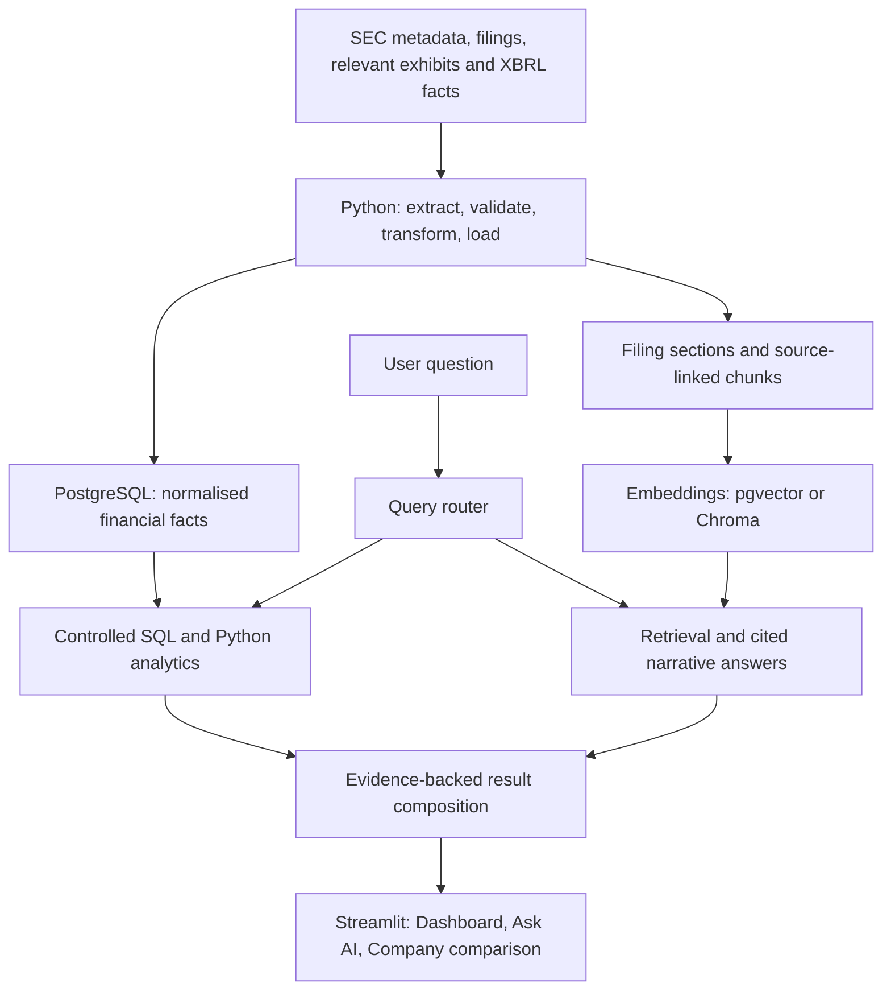

# Architecture and component contracts

## Implemented flow and boundaries

```text
SEC submissions -> scripts/ingest_filings.py -> data/filings.json
SEC filing HTML + filings.json -> scripts/process_filings.py
  -> data/raw_html/<accession>.html
  -> data/clean_text/<accession>.txt
  -> data/processed_filings.json
processed_filings.json + clean text -> scripts/summarize_filings.py
  -> data/summaries.json -> dashboard.py
```

All relative paths resolve from the working directory. The scripts orchestrate
the stages; `src/` owns reusable operations. No individual component owner or
deployment record is configured.

Operator entry points live in `scripts/` and run as `python -m scripts.<command>`
from the repository root. The metadata command is `scripts.ingest_filings`, formerly
root `main.py`. UI modules live in `src/ui/`; root `dashboard.py` and cloud
`demo/dashboard.py` remain thin launchers. Immutable historical reports retain
the filenames and hashes recorded at their original run, rather than being
rewritten to match the current layout.

| Capability | Implementation | Contract and failure behaviour |
|---|---|---|
| Metadata retrieval | `src/sec_client.py` | Returns records with `company`, `ticker`, `cik`, `form`, `filing_date`, `accession_number`, `document`, and `filing_url`. Dates are SEC strings; identifiers are strings. Malformed or misaligned metadata is rejected. `scripts/ingest_filings.py` records company failures; a 403 stops further requests in that run. |
| Metadata storage | `src/storage.py` | Writes UTF-8 JSON through a same-directory temporary file, flush/fsync and atomic replacement. Filesystem errors propagate; incomplete writes do not truncate the previous checkpoint. |
| HTML download | `src/filing_downloader.py` | Uses shared `src/sec_http.py`: five request starts/second per sequential process, timeouts, at most three attempts for connection failures, 429 and selected 5xx responses. Honours Retry-After up to 60 seconds; longer waits stop the run. A 403 is actionable and is not retried. Empty, non-HTML and known SEC block pages are rejected. |
| Text extraction | `src/html_parser.py` | BeautifulSoup with lxml removes scripts, hidden elements and selected XBRL tags, then returns nonempty lines. The processing script treats empty output as failure. |
| Processing checkpoint | `scripts/process_filings.py` | Copies metadata and adds `html_path`, `text_path`, `text_characters`, `processing_status`, and `processing_error`. Failed attempts have null paths, zero characters and an error string in `data/processing_status.json`. The main checkpoint is replaced only by a complete nonempty successful batch. |
| Summary generation | `src/summarizer.py`, `scripts/summarize_filings.py` | Summary records retain source metadata except `document`, adding `event_type`, `summary`, `source_word_count`, and `summary_method`. Failed processing records and missing/empty text are reported per filing; an incomplete batch preserves the previous summaries. Empty or unsuitable text produces explanatory fallback text. |
| Filing display | `src/ui/filing_ui.py` via `dashboard.py` | Loads the summaries array and filters by company/form in the Filings tab. Groups 8-Ks per company with dated newest-first entries, source links and expandable long summaries; 10-Q/10-K cards remain individual and metrics count filings. Shows per-stage freshness/status and expandable failure details. Missing or invalid summaries produce an error; an empty array produces an explicit warning. |
| Financial display | `src/analytics.py`, `src/ui/financial_ui.py` via `dashboard.py` | Read-only consistent PostgreSQL snapshot, exact-period Decimal KPIs, annual/quarterly graphs, company comparisons, missing-data flags and source exports. See [analytics contracts](analytics.md). |

Metadata arrays, filing identities, input-array shape, downloaded HTML and
dashboard summary fields are validated. These contracts do not yet have a
formal schema version. The summariser selects `8-K` rules for
that form and uses `10-Q` rules for all other supplied forms, including `10-K`.
Quarterly MD&A selection recognises line-anchored titles and chooses the longest
span before the next quarterly section. This avoids short table-of-contents
entries and prose references to earlier reports. An unrecognised heading retains
the whole-text fallback; unusual layouts and annual sections remain limitations.
For 8-Ks, repeated item numbers are resolved using their largest disclosure spans,
then the first body item in document order is selected. Contents page numbers do
not count as body text; item/signature boundaries are shared with summarisation.
Only primary filing documents are ingested today. Relevant exhibit discovery and
source-linked attachment ingestion are a recorded follow-up in the project brief.

## State, recovery and limitations

- Each stage publishes its JSON checkpoint only for a complete nonempty batch.
  Failures, partial batches and empty results exit with code 1 and preserve the
  previous checkpoint byte-for-byte. Success exits with code 0. This conservative
  policy does not merge old and new snapshots; correct the failures and rerun.
- `data/metadata_status.json`, `data/processing_status.json` and
  `data/summaries_status.json` describe the latest attempt, with UTC timestamps,
  status, per-item errors, record counts and `output_updated`. Reports are written
  as running before work begins. Checkpoint and report replacement are separate
  operations: interruption can leave freshness unconfirmed, which the UI warns
  about. Reports are overwritten each run, not an append-only audit history.
- Reprocessing reuses valid nonempty HTML by accession number. Known block pages
  and invalid cached content are refetched. Cache compatibility is not checked
  against code/dependency identities or content hashes. Successfully fetched raw
  files and extracted text may be saved even when the batch checkpoint is retained.
- Run stages sequentially, stopping on a nonzero exit. Downstream scripts can read
  older checkpoints if manually run after an upstream failure; the dashboard
  displays attempt timestamps and warnings. Concurrent runs are unsupported;
  request pacing is process-local, not a global cross-process rate limiter.
- To change parsing rules, rerun processing and summarisation. To change summary
  rules, rerun summarisation. To fetch fresh HTML, deliberately remove the
  relevant local cached HTML before reprocessing.
- Preserve a copy of `data/` before replacing checkpoints if prior results must
  remain available. Restart reads files; it does not restore execution progress.
- The dashboard is local. Authentication, tenant isolation, production readiness
  gates, deployment automation and release manifests are not implemented.

## Implemented structured-data path

`scripts/ingest_financials.py` orchestrates `src/xbrl.py` and the shared SEC request/storage
helpers. Companyfacts responses are retained as immutable byte snapshots, then
normalised into source-linked candidates and exact-period observations in
`data/financial_facts.json`. The stage report is `data/financials_status.json`.
Snapshot identities, code identities, metric/tag selection, duration buckets,
coverage and publication rules are defined in [financial-facts.md](financial-facts.md).
They are the contract consumed by the PostgreSQL importer. The narrative pipeline
and its five-filing limit remain separate. Financial charts now consume PostgreSQL;
quarterly cash-flow derivation remains unimplemented.

## Implemented database path

`scripts/database.py` uses `src/database.py` and checksum-tracked SQL migrations. It verifies
the XBRL artifact against its raw snapshots, then stores company/source identities,
NUMERIC facts, dataset-specific observations and run history in one transaction.
Current selected values are exposed through SQL views while older datasets remain
queryable. Schema, ordering, rollback, credentials and recovery contracts live in
[database.md](database.md). Raw snapshots stay in external files. Financial tabs
read PostgreSQL; the Filings tab remains a JSON consumer. `scripts/configure_database.py`
verifies/saves private local settings, and `scripts/refresh_data.py` checks/migrates,
ingests, validates and imports financial data. See [analytics](analytics.md) for
failure boundaries, date alignment and refresh behaviour.

## Frozen portfolio entry point

`src/ui/app.py` owns the shared page; root `dashboard.py` supplies local SQL mode.
`scripts/export_demo.py` reads a consistent current SQL snapshot and saved filing summaries,
allowlists public fields, validates them and atomically publishes `demo/snapshot.json`.
`src/demo.py` verifies and decodes exact date/Decimal inputs for `demo/dashboard.py`.
The demo never reads database settings or falls back to local pipeline files and
has no database-driver dependency. The calculation functions are shared between
both modes, with imports for SQL deferred until an actual SQL read.
See [deployment and manual updates](../demo/README.md). This implements frozen-data
packaging; public hosting is not yet deployed and monthly scheduling remains deferred.

## Target architecture (planned)

The delivery order and acceptance evidence live in [the project brief](problem.md).
The following diagram describes the complete target. Structured-fact ingestion,
PostgreSQL persistence, financial analytics and the narrative filing browser exist;
AI paths remain planned as identified in the project brief.



PostgreSQL stores structured facts and supports the implemented analytics. The vector-store choice
remains open: pgvector can share PostgreSQL persistence, while Chroma would be
a separate store. Choose one when implementing retrieval. Provider/model choice,
and embedding model remain unconfigured; financial history is configurable.

| Planned boundary | Required contract |
|---|---|
| Source ingestion | Store snapshot identity, retrieval time, source URL, CIK and accession where applicable; link each exhibit document to its parent accession and retain its own source URL/type; preserve raw payloads and report validation failures. |
| Normalised facts | Retain taxonomy/tag, unit, start/end or instant date, fiscal period, form, filing date and accession. Define selection rules for amendments, duplicate facts and tag mappings before calculating KPIs. Preserve source candidates alongside selected values. |
| Analytics | Accept validated company/metric/period inputs; use parameterised queries or allowlisted functions. Return value, unit, reporting period, formula and source identities. Refuse ambiguous or unavailable comparisons. |
| Narrative index | Retain accession, URL, section, chunk offsets and content hash. Record parser/chunking and embedding identities. Rebuild affected chunks or the index when those identities change incompatibly. |
| Retrieval and generation | Return evidence with citations. Distinguish absent evidence from retrieval/provider failure; abstain when unsupported. Retrieved prose cannot authorise tool calls or change system instructions. |
| Router and composition | Choose analytics, retrieval or both. Take numbers from analytical outputs and explanations from retrieved evidence; retain provenance through final rendering. |

Loads must be repeatable without duplicate selected facts or chunks. Keep filing
date/availability separate from reporting period for historical comparisons.
Any future point-in-time research must exclude information filed after its
cutoff. Planned evaluation must exercise these boundaries before live claims.

FastAPI and Docker are planned for the integration milestone, after the local
analytics and research paths work. Database migrations, persistence volumes,
startup checks, environment locking and recovery commands must be documented
and verified at implementation time. No deployment is implied by this design.

The runtime is [locked and clean-install verified](reproducibility.md) for one
Windows/CPython target. The small [development baseline](../evals/README.md) records
source and input identities; representative human-reviewed quality evaluation
remains future work. See [project checks](project-checks.md).
